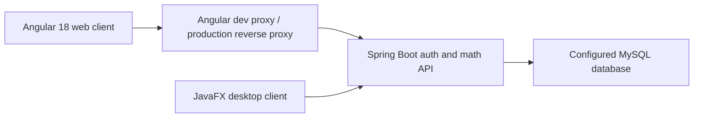

# NexusMath AI Web Completion Checklist

## Verified architecture

The workspace contains three independently built applications:

- `mathapp-angular/nexusmath-web`: Angular 18 web client.
- `auth-backend`: Spring Boot 3.3 / Java 17 authentication and math API.
- `mathapp`: JavaFX desktop client.

The Angular client calls the existing Spring API. It does not duplicate calculation logic or modify the JavaFX client. Authentication and math calculations require the backend; database setup and availability remain backend requirements.

The Angular dev server forwards relative `/api` requests to `NEXUSMATH_API_URL` (default `http://localhost:8081`) using [proxy.conf.js](./proxy.conf.js). This corrects the previous proxy target of port `8080`, which did not match the configured Spring development server port `8081`.

## Existing feature parity

Status legend: **Implemented** means the Angular interaction and corresponding API call exist; it does not claim a live deployment or per-endpoint integration test.

| Existing feature | Backend/API | Angular implementation | Tests | Status / remaining |
| --- | --- | --- | --- | --- |
| Login and registration | `POST /api/auth/login`, `/register` | `/login`, tab-scoped `sessionStorage` JWT session, route guard, bearer interceptor | Angular auth/interceptor tests; backend math suite does not exercise auth | Implemented; real DB/auth integration remains unverified |
| Forgot password | `POST /api/auth/forgot-password` | Forgot-password mode on `/login` | Angular request-contract test | Implemented; email delivery needs configured backend mail |
| Logout | `POST /api/auth/logout` | Sidebar sign-out and memory clear | Angular logout test | Implemented |
| Home/welcome and navigation | JavaFX `MainViewController` | `/dashboard`, responsive shared shell | Build only | Implemented; no activity/history API exists |
| Theme switch | Existing JavaFX dark/light themes | Sidebar dark/light theme toggle using shared palette | Build only | Implemented in client state; preference is not persisted |
| Arithmetic/simple calculator | `POST /api/math/arithmetic` | `/math`, seven operations, validated scalar fields | Authenticated arithmetic contract test; backend math tests | Implemented; no keypad/expression history UI |
| Equation solver | `POST /api/math/equations/solve` | Multi-line equation input and variable-values field | Equation contract test; backend math tests | Implemented |
| Sequences and series | `POST /api/math/sequences/evaluate` and `/analyze` | Sequence operation selector, input/target fields, and detailed sequence analysis | Backend math tests; Angular build | Implemented |
| Number properties | `POST /api/math/number-properties/evaluate` | Common integer, factor, list, HCF/LCM, and related operations | Backend number-property tests; Angular build | Partially implemented; backend supports more operations than the current selector |
| Matrices | `POST /api/math/matrices/evaluate` | Determinant, inverse, inverse-with-determinant; square matrix parser | Backend math tests; Angular build | Implemented |
| Correlation/statistics | `POST /api/math/statistics/correlation` | Matched X/Y input and optional target X | Backend math tests; Angular build | Implemented; API returns text, so no correlation chart is available |
| Regression | `POST /api/math/statistics/regression` | Linear, polynomial, exponential, logistic models; plots returned points when supplied | Backend math tests; Angular build | Implemented; chart availability depends on backend response points |
| Probability / combinatorics | `POST /api/math/combinatorics`, `/statistics/venn2`, `/statistics/bayes`, `/statistics/contingency` | Corresponding form flows with list and probability validation | Backend math tests; Angular build | Implemented; user-facing results are text |
| Distributions | `POST /api/math/distributions/evaluate` | Normal and binomial forms; report and graph from returned points | Backend math tests; Angular build | Implemented; graph uses backend-supplied data |
| Guide and About | No API required | `/guide`, `/about` | Build only | Implemented |
| JavaFX desktop behaviors | Existing JavaFX sources | Preserved; Angular has web equivalents where backend endpoints exist | JavaFX Maven tests: 3 passed | JavaFX files unchanged |

## Newly planned features (not represented as working)

- AI agent workspaces for DSA, mathematics, and physics are **not implemented**. The current `/agents` route discloses that the backend has no agent/LLM endpoint. Provider credentials must remain server-side.
- A browsable theory library is **not implemented**; the current `/theory` page describes backend capability areas and explicitly states that no content API exists.
- There is no calculation-history API/persistence contract, so the dashboard does not fabricate activity or usage counts.
- Full regression/correlation visualizations, simulations, graph interaction, export, and animation controls require additional existing backend data contracts or separately approved feature work.

## Figma and visual design

- The user supplied the [NexusMath AI UI Template](https://www.figma.com/design/brhGtgt3sOrsENFGk0wNdv/NexusMath-AI-%E2%80%93-UI-Template?node-id=0-1) URL; the file key is `brhGtgt3sOrsENFGk0wNdv`, with `0:1` in the shared link.
- Figma MCP authentication was verified. The initial design-context request reported that no layer was selected; the subsequent metadata request was blocked by the account's Figma MCP Starter-plan call limit.
- No screenshot, UI-kit metadata, design tokens, or assets were returned, so the supplied Figma file could not yet be compared or implemented.
- Current global colors and typography reuse the existing JavaFX `style.css` palette as a provisional cross-client baseline, not as a claim of Figma compliance.
- Figma fidelity, asset extraction, and screenshot comparison remain blocked until MCP access is available and the target screen/frame is selected or the metadata request can be retried.

## Verification evidence

| Check | Result | Notes |
| --- | --- | --- |
| Angular production build (`npm run build`) | Passed | Final production build completed without warnings; 288.45 kB raw initial bundle, below the configured 500 kB warning budget. |
| Angular unit tests (`npm test -- --watch=false --browsers=ChromeHeadless`) | Passed | 6 tests passed for math form validation/result rendering, authenticated arithmetic request contract, equation request/response handling, logout session clearing, and forgot-password request contract. |
| Spring backend tests (`mvn test` in `auth-backend`) | Passed | 19 tests; 0 failures, 0 errors, 0 skipped. Existing API/service tests. |
| JavaFX client tests (`mvn test` in `mathapp`) | Passed | 3 tests; 0 failures, 0 errors, 0 skipped. |
| Angular-to-Spring proxy smoke request | Passed | With `NEXUSMATH_API_URL=http://localhost:8081`, a test login request to Angular `/api/auth/login` returned the same backend validation status (HTTP 400) as a direct Spring request; this confirms forwarding, not successful authentication. |
| Browser smoke and responsive check | Passed | Angular loaded at `/dashboard`; unauthenticated `/math` redirected to `/login?returnUrl=...`; password-recovery UI and theme toggle rendered; at 390px viewport the page had no horizontal overflow. |
| Remaining live auth/math integration with database | Not run | The proxy was verified against the reachable Spring auth endpoint; a successful login and authenticated math calculation require a valid test account/database and are not claimed here. |
| Automated browser end-to-end and Figma screenshot comparison | Blocked | No E2E runner is configured; Figma MCP returned no selected layer and then enforced its Starter-plan call limit. |

## Run instructions

1. Configure/start the Spring service and MySQL using the instructions in `../../auth-backend/README.md`.
2. From this workspace, run `npm ci`, optionally set `$env:NEXUSMATH_API_URL = "http://localhost:8081"` in PowerShell, then run `npm start` (Angular serves at `http://localhost:4200` and forwards `/api` to the configured service URL).
3. Register/sign in at `/login`; navigate to `/math` and submit a calculation.
4. To build for production, run `npm run build`. Production hosting must reverse-proxy `/api` to the Spring API on the same origin.
5. The JavaFX client remains independently runnable from `../../mathapp` with `mvn javafx:run`.

## Next steps

1. Restore Figma MCP call availability and select/provide the intended screen frame; inspect its tokens/assets and compare screenshots at desktop and mobile widths.
2. Run a backend-backed test with a dedicated non-production test database and verify registration, login, math requests, error states, and reset-email flow.
3. Expand Angular API contract tests to cover every math endpoint and add browser E2E coverage for auth guard and key calculations.
4. Complete lower-priority parity gaps: remaining number-property operations, keypad calculator UX, exact JavaFX theme persistence behavior, and any graph reports requiring additional backend point data.
5. Only after parity and design fidelity, implement AI providers and separate Mathematics, DSA, and Physics agent workflows through secure backend contracts.
